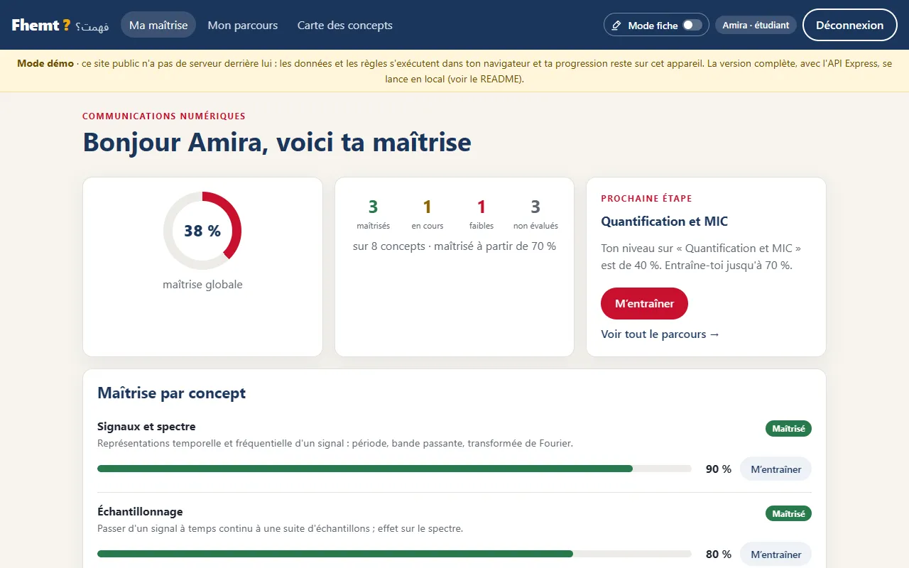
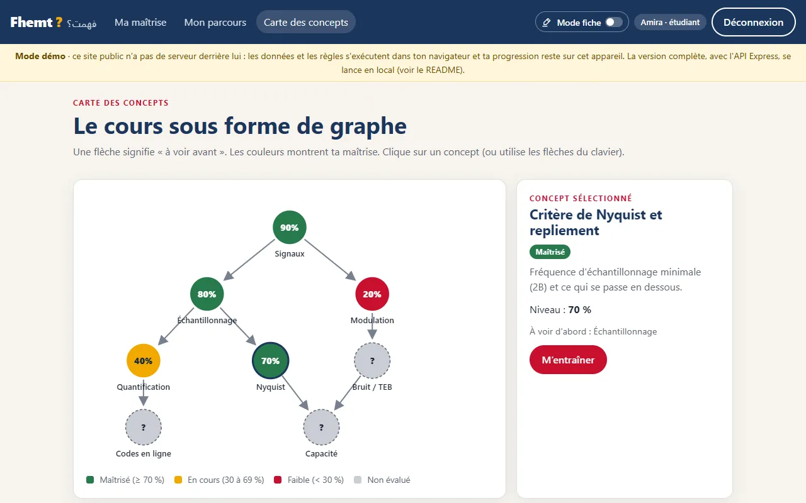
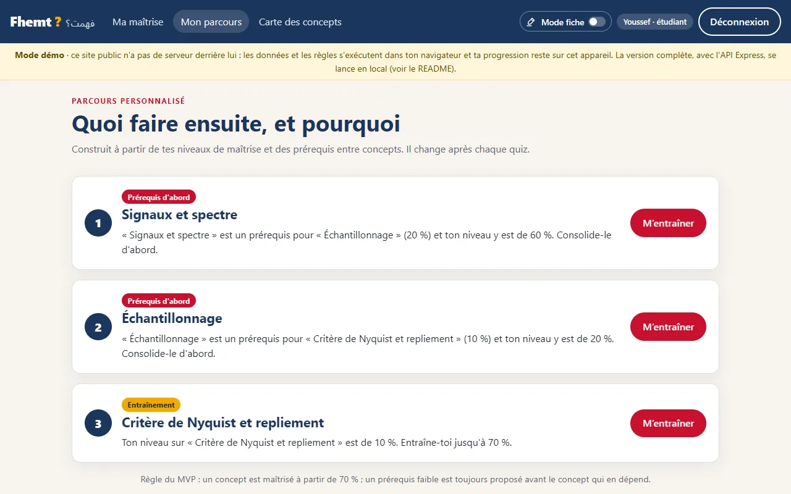
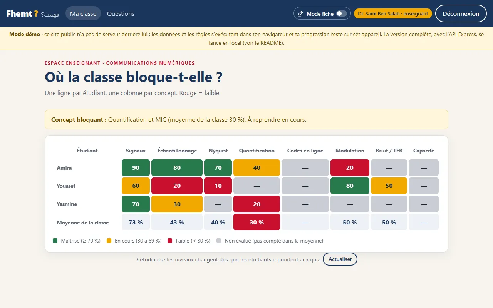
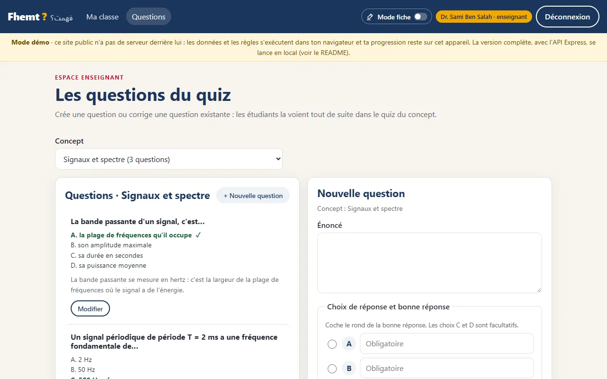
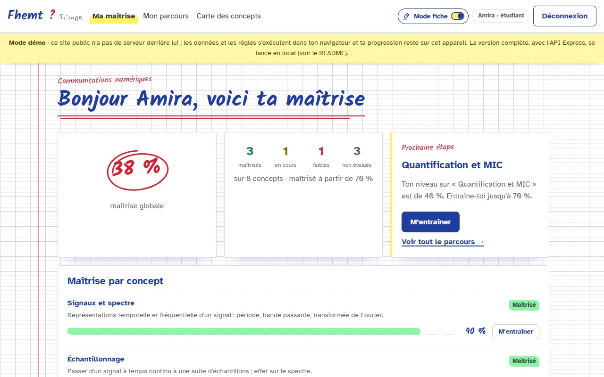
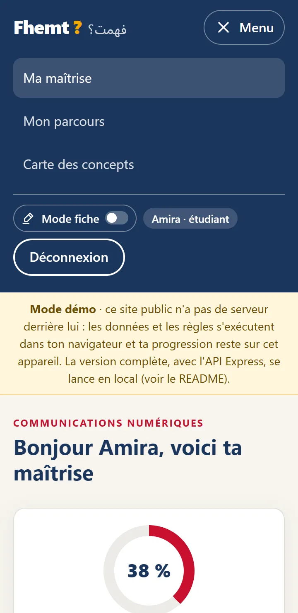
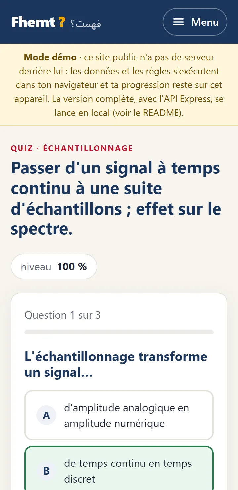

<div align="center">


[](https://fhemt.me)
[](https://github.com/RayenTouil/Fhemt-/actions/workflows/ci.yml)


**[▶ Essayer le site : fhemt.me](https://fhemt.me)**

</div>

---

## Pourquoi ce nom ?

**« Fhemt ? »** veut dire *« as-tu compris ? »* en arabe tunisien. Chaque étudiant se pose cette question la veille d'un examen, en général sans réponse claire. Fhemt ? y répond, **concept par concept**.

## Le problème

Les étudiants révisent ce qu'ils savent déjà et sautent le prérequis fragile. Les enseignants voient des notes, pas les concepts où la classe bloque.

Même note, lacunes opposées : la note cache ce que chaque étudiant doit réviser.

| Concept         | Amira · 12/20 | Youssef · 12/20 |
|-----------------|:-------------:|:---------------:|
| Échantillonnage | ✅ solide     | ⚠️ faible       |
| Nyquist         | ✅ solide     | ⚠️ faible       |
| Modulation      | ⚠️ faible     | ✅ solide       |

## Ce qu'est Fhemt ?

Une **application web éducative et interactive** : des quiz, un suivi de la progression, un parcours de révision personnalisé et, plus tard, un tuteur IA.
Première version : un seul cours, **Communications numériques** à Sup'Com.

**Proposition de valeur :** un parcours construit **pour chaque étudiant**, où chaque recommandation vient **avec sa raison**, et un tuteur IA qui répond **à partir du cours lui-même**.

## Public cible

| | Qui | Ce qu'ils attendent |
|---|---|---|
| 🎓 **Étudiants** (principal) | Étudiants d'écoles d'ingénieurs tunisiennes, 18–25 ans, qui étudient en français et en anglais | Savoir quoi réviser en premier, voir leur progression, avoir des réponses rapides. *« Plus que trois jours : par où je commence ? »* |
| 👩‍🏫 **Enseignants** (secondaire) | Responsables d'un cours et de ses exercices | Voir clairement où la classe bloque, de l'aide pour préparer les exercices. *« Quel prérequis dois-je reprendre en cours ? »* |

---

## Objectif 3 · Ce qui est construit (MVP)

Le périmètre du MVP vient de la priorisation des fonctionnalités de l'objectif 2 : d'abord la **boucle principale** (quiz → maîtrise → parcours → vue de la classe), les composants IA et l'infrastructure ensuite.

| Page | Route | Contenu dynamique | Pour qui |
|---|---|---|---|
| **Accueil** | `/` | Présentation, exemple, « comment ça marche » | tout le monde |
| **Connexion** | `/login` | Connexion par e-mail ; les nouveaux comptes sont étudiants, le rôle est stocké côté serveur | tout le monde |
| **Ma maîtrise** | `/dashboard` | Niveau global, compteurs, prochaine étape, une barre de progression par concept | étudiant |
| **Quiz** | `/quiz/:conceptId` | 3 questions par concept, correction immédiate et explication, maîtrise mise à jour après chaque réponse | étudiant |
| **Mon parcours** | `/path` | Les prochaines étapes avec leur raison (*« Échantillonnage » est un prérequis pour « Nyquist » (10 %) et ton niveau y est de 20 %*) | étudiant |
| **Carte des concepts** | `/concepts` | Graphe SVG des 8 concepts et de leurs prérequis, coloré selon la maîtrise, cliquable | étudiant |
| **Ma classe** | `/teacher` | Carte de chaleur étudiants × concepts, moyennes de la classe, concept bloquant | enseignant uniquement |

**Les règles du MVP (faciles à expliquer, faciles à changer) :**
- Maîtrise : bonne réponse **+20**, mauvaise réponse **−10**, niveau entre 0 et 100 ([`backend/src/services/mastery.js`](backend/src/services/mastery.js)).
- Un concept est **maîtrisé à partir de 70 %**, *en cours* à partir de 30 %, *faible* en dessous.
- Parcours : on suit l'ordre du cours ; un **prérequis faible passe toujours avant** le concept qui en dépend, et la raison le dit ([`backend/src/services/path.js`](backend/src/services/path.js)).
- Droits d'accès : le backend lit l'utilisateur dans l'en-tête `x-user-id` et vérifie le **rôle** (étudiant / enseignant / admin) sur les routes enseignant ; les guards Angular reproduisent ces vérifications pour la navigation.

**Contenu du cours :** 8 concepts de Communications numériques (signaux, échantillonnage, Nyquist, quantification, codes en ligne, modulation, bruit/TEB, capacité) avec leurs prérequis et 24 QCM expliqués, dans [`backend/data/seed/`](backend/data/seed/).

## Objectif 4 · Le site finalisé

Le prototype de l'objectif 3 devient une version quasi finale : toutes les pages du plan du site, des composants réutilisables, la création et la mise à jour de données, une interface responsive et accessible, des performances mesurées et un code vérifié automatiquement.

### Plan du site

Le sujet de notre objectif 2 portait sur la découverte produit (personas, MVP, SWOT) : il ne contenait pas de plan du site. Le voici, tel qu'il est routé dans [`app.routes.ts`](frontend/src/app/app.routes.ts). Les pages publiques sont aussi déclarées aux moteurs de recherche dans [`public/sitemap.xml`](frontend/public/sitemap.xml).

| Page | Route | Accès | Nouveau |
|---|---|---|---|
| Accueil | `/` | tout le monde | |
| À propos (projet, équipe, étapes, technologies) | `/about` | tout le monde | ✨ |
| Contact (formulaire) | `/contact` | tout le monde | ✨ |
| Connexion | `/login` | tout le monde | |
| Ma maîtrise | `/dashboard` | connecté | |
| Mon parcours | `/path` | connecté | |
| Carte des concepts | `/concepts` | connecté | |
| Quiz d'un concept | `/quiz/:conceptId` | connecté | |
| Mon profil (nom et préférences) | `/profile` | connecté | ✨ |
| Ma classe (carte de chaleur) | `/teacher` | enseignant, admin | |
| Questions du quiz (créer, modifier) | `/teacher/questions` | enseignant, admin | ✨ |
| Page introuvable (404) | toute autre adresse | tout le monde | ✨ |

**Routing :** chaque page est chargée à la demande (`loadComponent`, *lazy loading*), sauf l'accueil, livré avec l'application parce que c'est la page d'entrée. Le retour en haut de page et les ancres sont gérés (`withInMemoryScrolling`), un fondu accompagne chaque changement de page (`withViewTransitions`), chaque page a son titre d'onglet, le lien de la page active est marqué (`aria-current`) et les guards protègent les pages réservées.

### Composants réutilisables

Les pages ne répètent plus de HTML : elles assemblent des composants du dossier [`frontend/src/app/shared/`](frontend/src/app/shared/).

| Composant | Rôle | Utilisé par |
|---|---|---|
| `app-page-header` | étiquette, titre h1, sous-titre, zone d'actions | toutes les pages intérieures |
| `app-mastery-bar` | barre de maîtrise (jauge accessible `role="meter"`) | accueil, tableau de bord |
| `app-status-badge` | pastille « Maîtrisé / En cours / Faible » ou type d'étape | tableau de bord, parcours, carte |
| `app-mastery-legend` | légende des 4 couleurs | carte des concepts, vue enseignant |
| `app-form-field` + `appFieldControl` | libellé, champ, aide, erreur, reliés pour les lecteurs d'écran | connexion, contact, profil, questions |
| `app-skeleton` | squelette de chargement (6 formes) | toutes les pages qui chargent des données |
| `app-error-state` | message d'erreur + bouton « Réessayer » | idem |
| `app-empty-state` | état vide qui dit quoi faire ensuite | tableau de bord, parcours, vue enseignant |
| `app-navbar`, `app-footer` | navigation selon le rôle (menu burger sur mobile), pied de page | coquille de l'application |
| `app-concept-graph` | le graphe SVG, utilisable au clavier | carte des concepts |

Les **cartes** et les **boutons** restent des classes CSS du design system (`.card`, `.btn`, `.btn--primary`…) : en faire des composants Angular n'ajouterait qu'une balise autour, sans logique.

**Organisation des dossiers et correspondance avec l'énoncé** (qui cite `/components`, `/pages`, `/assets`, `/hooks`, des noms venant de React) :

| Énoncé | Fhemt ? (conventions Angular) | Contenu |
|---|---|---|
| `/pages` | `src/app/pages/` | une page par route (`home`, `login`, `dashboard`, `contact`…) |
| `/components` | `src/app/shared/` | les composants réutilisables ci-dessus |
| `/hooks` | `src/app/core/` | services, guards, modèles, règles de validation. L'équivalent d'un hook React comme `useFetch` est **`rxResource`** d'Angular : chaque page l'utilise pour obtenir `value()`, `isLoading()`, `error()` et `reload()` |
| `/assets` | `public/` | favicon, `robots.txt`, `sitemap.xml`, données du mode démo |

Le design reste celui de l'objectif 2 (bleu marine, rouge, or sur fond crème) : toutes les couleurs, rayons, ombres et espacements sont des variables CSS dans [`styles.css`](frontend/src/styles.css), avec une échelle d'espacement de 4 px comme Material Design et Tailwind. Aucune page n'écrit de couleur en dur. Tout fonctionne aussi dans le second habillage, le **mode fiche de révision** ([`ui-fiche.css`](frontend/src/ui-fiche.css)).

### Données dynamiques : affichage, création, mise à jour

Le site est branché sur la **vraie API Express**. Chaque nouvelle fonctionnalité existe aussi en **mode démo** (`DemoApi`, données dans le `localStorage`), avec les mêmes règles. Le compilateur vérifie que les deux offrent les mêmes méthodes (`DemoApi implements ApiContract`).

| Action | Page | API (Express) | Accès |
|---|---|---|---|
| **Créer** un message | `/contact` | `POST /api/contact` | tout le monde |
| **Mettre à jour** son nom et ses préférences (habillage, animations) | `/profile` | `PATCH /api/users/me` | connecté (jamais l'e-mail ni le rôle) |
| **Afficher** les questions d'un concept avec leurs réponses | `/teacher/questions` | `GET /api/teacher/questions?conceptId=` | enseignant, admin |
| **Créer** une question (elle apparaît aussitôt dans le quiz des étudiants) | `/teacher/questions` | `POST /api/teacher/questions` | enseignant, admin |
| **Modifier** une question | `/teacher/questions` | `PUT /api/teacher/questions/:id` | enseignant, admin |

La validation est faite deux fois : par le formulaire pendant la saisie (champs requis, format de l'e-mail, longueurs), puis par le serveur ([`services/validation.js`](backend/src/services/validation.js)), qui renvoie `400 { error, fields }`. Le site affiche alors chaque message sous le bon champ. Les règles et les messages sont identiques côté serveur et en mode démo ([`core/validation.ts`](frontend/src/app/core/validation.ts)).

### UX/UI et accessibilité

- **États de chargement :** squelettes à la forme du contenu, `aria-busy` pendant le chargement, boutons « Envoi… » avec un indicateur, état d'erreur avec « Réessayer », états vides utiles (« Aucun concept évalué : commence par un quiz »).
- **Animations légères, en CSS seulement :** apparition des cartes, barres et anneau qui se remplissent, reflet des squelettes, fondu entre les pages. Toutes sont coupées si le système demande moins d'animations (`prefers-reduced-motion`) ou si l'utilisateur coche « Réduire les animations » dans son profil.
- **Responsive :** menu burger sous 900 px (téléphone et tablette) avec `aria-expanded`, fermeture par Échap et au changement de page. Les 12 pages ont été vérifiées à 360, 768 et 1280 px dans les deux habillages, sans débordement horizontal.
- **Accessibilité :**
  - lien « Aller au contenu », titres dans l'ordre h1 → h2 → h3, un libellé sur chaque champ ;
  - zones `aria-live` pour la correction du quiz et les confirmations, contour de focus visible partout, `lang="ar"` sur le texte arabe ;
  - carte des concepts utilisable au clavier : flèches, Début/Fin, Entrée/Espace, chaque concept annonce son niveau et ses prérequis.

  Résultat : 0 erreur axe-core (WCAG 2.1 AA) sur les 12 pages, à 360 et 1280 px, dans les deux habillages.
- **Contrastes mesurés et corrigés** (seuil AA : 4,5:1 pour le texte, 3:1 pour les graphiques). L'identité ne change pas : l'or reste la couleur des remplissages.

| Texte / fond | Avant | Après |
|---|---|---|
| texte secondaire `--muted` sur crème | 4,40 ✗ | **5,27** (#5f6672) |
| blanc sur `--green` (pastille « Maîtrisé ») | 4,25 ✗ | **5,28** (#277a4c) |
| texte sur `--gold` (« En cours », cellules) | 2,01 ✗ (blanc) | **7,62** (marine foncé) |
| or utilisé comme texte (compteur « en cours ») | 3,56 ✗ | **4,85** (`--gold-text` #8a6500) |
| « ? » des concepts non évalués | 1,59 ✗ | **9,74** (encre sur gris) |
| contour de focus des champs | 2,01 ✗ (or) | **12,1** (marine) |
| flèches de la carte des concepts | 3,06 | **4,0** |

### Performance

Mesuré sur la version compilée en mode démo, servie en local avec compression gzip comme sur GitHub Pages (`npm run build` puis `npm run serve:dist`).

**Lighthouse** (Performance / Accessibilité / Bonnes pratiques / SEO) :

| Page | Avant (objectif 3) | Après (objectif 4) |
|---|---|---|
| `/` mobile | 99 / 96 / 100 / 91 | **100 / 100 / 100 / 100** |
| `/` desktop | 100 / 96 / 100 / 91 | **100 / 100 / 100 / 100** |
| `/login` mobile | 100 / 96 / 100 / 91 | **100 / 100 / 100 / 100** |
| `/login` desktop | 100 / 96 / 100 / 91 | **100 / 100 / 100 / 100** |

Les points perdus avant venaient des contrastes et de l'absence de `robots.txt`. Les autres pages, mesurées une fois connecté, obtiennent toutes **98 à 100** dans les quatre catégories : `/dashboard`, `/path`, `/concepts`, `/quiz/sampling`, `/profile`, `/teacher`, `/teacher/questions`, `/about`, `/contact`.

<details>
<summary><strong>Mesurer une page protégée soi-même dans Chrome DevTools</strong></summary>

1. `npm run build` puis `npm run serve:dist` dans `frontend/`, et ouvre http://localhost:4300 dans Chrome.
2. Connecte-toi avec un compte de démonstration (par exemple `amira@fhemt.tn`, ou `teacher@fhemt.tn` pour les pages enseignant).
3. Ouvre la page à mesurer (par exemple `/dashboard`), puis **F12** → onglet **Lighthouse**.
4. Choisis **Mobile** ou **Desktop** et les quatre catégories, puis clique sur **Analyze page load**.
5. **Important :** dans les réglages du panneau Lighthouse (roue dentée), décoche **« Clear storage »** (« Effacer l'espace de stockage »). Sinon Lighthouse vide le `localStorage` avant la mesure : tu serais déconnecté et la page mesurée serait `/login`.
6. Fais l'analyse dans une fenêtre sans extensions (navigation privée, où tu te connectes d'abord), les extensions faussent les résultats.

</details>

**Ce qui a été fait, et ce qui a été mesuré puis écarté :**
- **Lazy loading :** 11 pages sur 12 sont des fichiers séparés de 1 à 12 kB. Les formulaires d'Angular (62 kB) ne se chargent que sur les pages qui en ont. Bundle initial : 365,7 kB (96,4 kB transférés) avant, 359,2 kB (96,6 kB transférés) après. Il contient surtout Angular lui-même (environ 300 kB) ; notre code n'y pèse que 27 kB, alors que le site est passé de 7 à 12 pages.
- **Préchargement :** le code des autres pages est téléchargé 2 s après l'arrivée ([`core/preloading.ts`](frontend/src/app/core/preloading.ts)), pour des clics instantanés. Le précharger tout de suite retardait l'affichage de l'accueil sur mobile (2,7 s au lieu de 0,6 s pour `/login`).
- **Stabilité de la mise en page :** la hauteur de `<main>` est réservée. Sans cela, le pied de page sautait à l'arrivée du code des pages (CLS 0,53, ramené à 0).
- **`@defer` testé puis retiré :** sur le graphe des concepts, il ajoutait environ 10 kB au bundle initial (le code d'Angular qui gère les blocs différés) pour différer seulement 5,7 kB d'une page déjà chargée à la demande.
- **Images :** le site n'a aucune image matricielle (choix de l'objectif 2 : « SVG plutôt qu'images »), et toutes les icônes sont en SVG dans le HTML. Le favicon d'Angular (15 Ko) est remplacé par un SVG de 0,5 Ko (+ une icône PNG pour l'écran d'accueil des iPhone). Les captures de ce README sont en WebP. Les polices du mode fiche se chargent seulement quand ce mode est choisi, avec `display=swap` et `preconnect`.

### Qualité du code

- **ESLint** (`ng add angular-eslint`, avec les règles d'accessibilité des templates) et **Prettier** : aucune erreur. **TypeScript strict** et `strictTemplates` sont activés : les erreurs de types dans les templates sont détectées à la compilation.
- Imports et code morts supprimés, un commentaire en français en tête de chaque fichier.
- La CI vérifie à chaque push : ESLint, Prettier, compilation, tests du frontend et du backend, démarrage de l'API.

### Tests et navigateurs

- **31 tests Vitest :** `DemoApi` (création et modification de questions, refus 403, profil, contact, maîtrise), règles de validation, préférences d'affichage, composants partagés, `FormField`, menu burger, carte des concepts au clavier, coquille de l'application.
- **30 tests `node:test` :** règles, validation, routes de création et de mise à jour par de vraies requêtes HTTP, ancienne base complétée sans perte, et un test qui vérifie que `backend/data/seed/` et `frontend/public/demo/` sont identiques (pour que le mode démo ne diverge jamais).
- **Parcours complet automatisé** ([`frontend/e2e/parcours.mjs`](frontend/e2e/parcours.mjs), `npm run e2e`) : accueil → connexion démo → tableau de bord → quiz → profil → déconnexion → connexion enseignant → carte de chaleur → création d'une question. Sur téléphone, la navigation passe par le menu burger.

| Navigateur | Téléphone (360 px) | Ordinateur (1280 px) |
|---|---|---|
| Chrome | ✅ 9 étapes | ✅ 9 étapes |
| Edge | ✅ 9 étapes | ✅ 9 étapes |
| Firefox | ⏳ à vérifier à la main (pas installé sur notre poste de test) | ⏳ idem |

Pour Firefox, suis le même parcours à la main avec l'outil « Vue adaptative » (Ctrl + Maj + M) en 360 px, puis en plein écran.

### Captures d'écran

<table>
<tr>
<td width="50%"></td>
<td width="50%"></td>
</tr>
<tr>
<td></td>
<td></td>
</tr>
<tr>
<td></td>
<td></td>
</tr>
</table>

<p align="center">

&nbsp;

</p>

## Le site en ligne : fhemt.me

**https://fhemt.me** est la version publique, en **mode démo**. GitHub Pages n'héberge que des fichiers statiques, donc il n'y a pas de serveur Express derrière : la même logique (mêmes données, mêmes règles) tourne dans le navigateur ([`frontend/src/app/core/demo-api.ts`](frontend/src/app/core/demo-api.ts)) et la progression de chaque visiteur reste sur son appareil. Un bandeau jaune le signale.

Comment c'est relié :

1. Le domaine **fhemt.me** est acheté chez **Namecheap** ; ses enregistrements DNS pointent vers les serveurs de GitHub Pages.
2. GitHub Pages sert le dépôt **[RayenTouil.github.io](https://github.com/RayenTouil/RayenTouil.github.io)**, qui contient uniquement le site compilé et le fichier `CNAME`.
3. `npm run deploy` (dans `frontend/`) compile le site et le publie dans ce dépôt ([`frontend/scripts/deploy.mjs`](frontend/scripts/deploy.mjs)). Le site est à jour en une minute environ.

Pour brancher fhemt.me sur la vraie API, il suffit d'héberger le backend (fichier [`render.yaml`](render.yaml) prêt pour Render, gratuit) et de mettre son adresse dans `frontend/src/environments/environment.prod.ts`.

## Lancer le projet en local (version complète avec l'API)

Prérequis : [Node.js](https://nodejs.org) 20 ou plus récent (testé avec Node 24). Rien d'autre à installer : pas de serveur de base de données, pas de Docker.

```bash
git clone https://github.com/RayenTouil/Fhemt-.git
cd Fhemt-

# Terminal 1 — l'API (http://localhost:3000)
cd backend
npm install
npm run dev          # crée data/db.json à partir des données seed au premier démarrage

# Terminal 2 — l'application Angular (http://localhost:4200)
cd frontend
npm install
npm start
```

Ouvre **http://localhost:4200** et connecte-toi avec un compte de démonstration :

| E-mail | Rôle | Ce que tu verras |
|---|---|---|
| `amira@fhemt.tn` | étudiante | à l'aise en échantillonnage, faible en modulation |
| `youssef@fhemt.tn` | étudiant | prérequis fragiles : le parcours le renvoie vers les signaux puis l'échantillonnage |
| `teacher@fhemt.tn` | enseignant | la carte de chaleur de la classe |

N'importe quel autre e-mail crée un nouveau compte étudiant. `npm run reset` dans `backend/` remet les données de démonstration.

**Routes de l'API :** `GET /api/health`, `GET /api/concepts`, `GET /api/mastery/me`, `GET /api/path/me`, `GET /api/quiz/:conceptId`, `POST /api/quiz/answer`, `PATCH /api/users/me`, `POST /api/contact`, `GET /api/teacher/heatmap`, `GET` / `POST` / `PUT /api/teacher/questions` (avec l'en-tête `x-user-id`). Détails dans [`backend/README.md`](backend/README.md).

## Tests et qualité

| Commande | Où | Ce qu'elle vérifie |
|---|---|---|
| `npm test` | `backend/` | 30 tests : règles, validation, routes de l'API, synchronisation seed / mode démo |
| `npx ng test --watch=false` | `frontend/` | 31 tests Vitest : composants partagés, services, mode démo |
| `npm run lint` | `frontend/` | ESLint (TypeScript, Angular, accessibilité des templates) |
| `npm run format:check` | `frontend/` | Prettier : la mise en forme est homogène (`npm run format` la corrige) |
| `npm run build` | `frontend/` | compilation de production (TypeScript strict, budgets de taille) |
| `npm run serve:dist` | `frontend/` | sert le site compilé sur http://localhost:4300 (pour Lighthouse et le parcours) |
| `npm run e2e` | `frontend/` | le parcours complet dans Chrome et Edge, à 360 et 1280 px (prérequis : `npm i --no-save puppeteer-core`, et `serve:dist` lancé) |

À chaque push, GitHub Actions ([`.github/workflows/ci.yml`](.github/workflows/ci.yml)) lance ESLint, Prettier, la compilation et les tests du frontend, puis les tests du backend, et vérifie que l'API démarre et répond.

## Structure du projet

```
Fhemt/
├── frontend/                    Angular 22 (composants standalone, signals, router)
│   ├── src/app/
│   │   ├── pages/               une page par route : home, about, contact, login, dashboard, path,
│   │   │                        concept-map (+ concept-graph), quiz, profile, teacher,
│   │   │                        question-editor, not-found
│   │   ├── shared/              composants réutilisables : navbar, footer, page-header, mastery-bar,
│   │   │                        status-badge, mastery-legend, form-field, skeleton, empty-state,
│   │   │                        error-state
│   │   ├── core/                api.ts (HttpClient + intercepteur), demo-api.ts (mode démo),
│   │   │                        auth.ts, guards.ts, models.ts, levels.ts, validation.ts,
│   │   │                        forms.ts, ui-mode.ts (préférences), preloading.ts
│   │   ├── app.routes.ts        le plan du site (lazy loading)
│   │   └── app.config.ts        router, HttpClient, choix API réelle / mode démo
│   ├── src/styles.css           le design system (variables, composants, animations)
│   ├── src/ui-fiche.css         le second habillage : « fiche de révision »
│   ├── src/environments/        adresse de l'API (dev : localhost, prod : vide = mode démo)
│   ├── public/                  favicon, robots.txt, sitemap.xml, demo/ (copie des seeds)
│   ├── e2e/parcours.mjs         le parcours complet dans de vrais navigateurs
│   └── scripts/                 deploy.mjs (publication sur fhemt.me), serve-dist.mjs
├── backend/                     API REST Node.js + Express 5
│   ├── src/app.js               application : middlewares, routes, erreurs JSON
│   ├── src/server.js            démarrage (port 3000)
│   ├── src/routes/              auth, concepts, contact, quiz, mastery, path, teacher, users
│   ├── src/services/            règles de maîtrise, de parcours et de validation (fonctions pures)
│   ├── src/middleware/auth.js   requireUser / requireRole (RBAC)
│   ├── src/store.js             stockage dans un fichier JSON (même forme que de futures requêtes MongoDB)
│   ├── data/seed/               concepts, questions, comptes, maîtrise et messages de démonstration
│   └── test/                    tests des règles, de la validation et des routes
├── .github/workflows/ci.yml     intégration continue
├── render.yaml                  hébergement optionnel de l'API sur Render
└── assets/                      images du README (captures en WebP)
```

## Choix techniques

- **Angular** (le framework vu en cours) : composants standalone, **signals** pour l'état des pages, **router** pour les 12 pages, chargées à la demande, avec des **guards**, `HttpClient` avec un **intercepteur** qui ajoute l'en-tête utilisateur, la nouvelle syntaxe `@if` / `@for`, et l'**injection de dépendances** pour basculer entre la vraie API et le mode démo sans toucher aux pages. Pas de bibliothèque d'interface : un petit design system écrit à la main ([`frontend/src/styles.css`](frontend/src/styles.css)) et une mise en page responsive (téléphone, tablette, ordinateur).
- **Express 5** pour un backend REST minimal : un fichier par fonctionnalité, des middlewares pour le contrôle d'accès, des fonctions pures pour les règles, donc testables sans HTTP.
- **Un fichier JSON comme base de données** pour le MVP : aucune installation pour le correcteur, et le module de stockage garde la forme des requêtes MongoDB, donc le passage à MongoDB ne touche qu'un fichier.
- **Connexion par e-mail** pour le MVP, avec le rôle décidé côté serveur. La connexion Google via Firebase remplacera la route de connexion sans toucher aux pages.

## Architecture du MVP

Ce schéma montre ce qui est **réellement construit** dans ce dépôt.

<p align="center">
  
</p>

**① En local, la version complète.** L'application Angular envoie ses requêtes à l'API Express avec l'en-tête `x-user-id`. Le middleware vérifie qui est connecté et son rôle, la route appelle la règle concernée, puis lit ou écrit le fichier `data/db.json`. Exemple quand un étudiant répond à un quiz : `POST /api/quiz/answer` → `requireUser` → règle de maîtrise (+20 / −10) → `db.json` → la correction et le nouveau niveau reviennent tout de suite à la page.

**② En ligne, sur fhemt.me.** GitHub Pages ne sert que des fichiers statiques. La version publiée utilise donc `DemoApi` au lieu d'`ApiService` : les mêmes données et les mêmes règles tournent dans le navigateur, et la progression reste dans le `localStorage`. Le choix se fait dans `environment.apiUrl`, sans toucher aux pages.

**③ Le code et la mise en ligne.** Chaque push sur GitHub lance la CI (compilation, tests, démarrage de l'API). `npm run deploy` compile le site et le publie dans le dépôt `RayenTouil.github.io`, que GitHub Pages sert sur fhemt.me grâce au DNS de Namecheap.

## Du MVP à l'architecture cible

L'objectif 1 décrivait une architecture événementielle plus large. La priorisation de l'objectif 2 a décidé de ce dont le MVP a vraiment besoin ; le reste viendra quand une fonctionnalité le justifiera.

| Composant de l'architecture cible | Dans le MVP (objectif 3) | Ensuite |
|---|---|---|
| Angular | ✅ 12 pages (objectif 4), mode démo | page de discussion avec le tuteur IA |
| Node.js + Express | ✅ API REST, contrôle des rôles | vérification du jeton Firebase |
| **MongoDB** | ➖ remplacé par un fichier JSON (`store.js`) | MongoDB Atlas (offre gratuite) : seul `store.js` change |
| Connexion Google **Firebase** | ➖ connexion par e-mail, rôle côté serveur | objectif suivant |
| **FastAPI + Qdrant + Groq** (tuteur, RAG) | ➖ | dernier objectif : le principal élément différenciant |
| **Cloudinary** (fichiers du cours) | ➖ | avec le tuteur |
| Cache **Redis** / événements **RabbitMQ** | ➖ aucune tâche lente pour l'instant | seulement si le tuteur ralentit les requêtes |
| E-mails **Mailjet** | ➖ exclus du MVP | optionnel |
| Hébergement | ✅ GitHub Pages sur fhemt.me (mode démo) | API hébergée sur Render ([`render.yaml`](render.yaml)) |

<details>
<summary><strong>Voir l'architecture cible complète (objectif 1, pas encore construite)</strong></summary>

<br>

Les actions rapides reçoivent une réponse tout de suite. Les tâches lentes (IA, e-mails, statistiques) passent par une **file de messages**, pour que l'étudiant n'attende jamais.

<p align="center">
  
</p>

- **Un étudiant répond à une question** : Node.js corrige la réponse et publie `answer.submitted` ; le service IA met à jour la maîtrise et le parcours.
- **Un enseignant dépose un PDF de cours** : stocké sur Cloudinary, découpé et indexé dans Qdrant pour le tuteur.
- **Un étudiant interroge le tuteur** : le tuteur retrouve les bons passages du cours (Qdrant), Groq rédige la réponse et cite la page.

</details>

## Droits d'accès (RBAC)

- **Trois rôles :** étudiant, enseignant, admin. Le rôle est stocké sur le serveur ; les nouveaux comptes sont étudiants, et un compte enseignant est attribué à la main dans les données.
- **Vérification du rôle (codée) :** `requireRole('teacher', 'admin')` protège toutes les routes enseignant (carte de chaleur, liste, création et modification des questions) ; un étudiant reçoit une erreur 403, et le guard Angular le renvoie vers son tableau de bord. Le profil (`PATCH /api/users/me`) ne modifie jamais l'e-mail ni le rôle, même si le client les envoie.
- **Vérification de la propriété (prévue) :** quand chaque enseignant aura ses propres cours, le serveur vérifiera aussi *« est-ce **ton** cours ? »*. Le MVP n'a qu'un seul cours, donc cette règle n'est pas encore nécessaire.

## Comment mesurer le succès

- Gain de maîtrise entre le premier quiz et la fin
- Un parcours adaptatif comparé à un parcours fixe sur un petit groupe d'étudiants
- Part des exercices terminés
- Étudiants actifs par semaine et questions posées au tuteur

## Avancement

- [x] **Objectif 1 :** définition du projet et périmètre fonctionnel
- [x] **Objectif 2 :** découverte produit assistée par l'IA (personas, matrice MVP, SWOT, concurrents)
- [x] **Objectif 3 :** MVP fonctionnel — 7 pages dynamiques, API Express, tests, site en ligne sur fhemt.me
- [x] **Objectif 4 :** site finalisé — 12 pages, composants réutilisables, création et mise à jour (API + mode démo), UX et accessibilité, Lighthouse 100, ESLint/Prettier, 61 tests
- [ ] Ensuite : MongoDB Atlas, connexion Google Firebase, tuteur IA (RAG)

## Inspirations visuelles

[Khan Academy](https://www.khanacademy.org) · [Duolingo](https://www.duolingo.com) · [ALEKS](https://www.aleks.com) · [NotebookLM](https://notebooklm.google)

## Équipe et répartition des rôles

Projet web Sup'Com 2025/2026, encadré par Dr. Maroua Nouioua, réalisé par :

| Membre | Rôles et contributions |
|---|---|
| **Rayen Touil** | *À COMPLÉTER* |
| **Wajdi Zentani** | *À COMPLÉTER* |

---

<div align="center">

**Fini de réviser à l'aveugle :** chaque étudiant sait ce qu'il maîtrise, ce qui lui manque et quoi faire ensuite, et chaque enseignant voit où la classe a besoin de lui.

</div>
