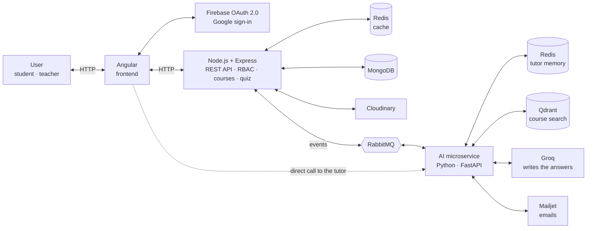

# Fhemt ? · فهمت؟

**Know what you've mastered. Learn what's next.**

Adaptive learning web platform · Sup'Com Web Project

---

## Why this name?

**« Fhemt ? »** means *"did you get it?"* in Tunisian Arabic. Every student asks themselves this the night before an exam, usually without a clear answer. Fhemt ? answers it, **concept by concept**.

## The problem

Students revise what they already know and skip the weak prerequisite. Teachers see grades, not the concepts where the class is stuck.

Same grade, opposite gaps: the grade hides what each student should revise.

| Concept    | Amira · 12/20 | Youssef · 12/20 |
|------------|:-------------:|:---------------:|
| Sampling   | ✅ strong     | ⚠️ weak         |
| Nyquist    | ✅ strong     | ⚠️ weak         |
| Modulation | ⚠️ weak       | ✅ strong       |

## What Fhemt ? is

An **educational, interactive web application**: quizzes, progress tracking, a personalised study path and an AI tutor.
First version: one course, **Digital Communications** at Sup'Com.

**Value proposition:** a study path built **for each student**, where every recommendation comes **with its reason**, plus an AI tutor that answers **from the course itself**.

## Target audience

| | Who | What they expect |
|---|---|---|
| 🎓 **Students** (main) | Tunisian engineering and university students, 18–25, study in French and English | Know what to revise first, see their progress, get quick answers. *"Three days left: where do I start?"* |
| 👩‍🏫 **Teachers** (secondary) | In charge of a course and its exercises | A clear view of where the class is stuck and help preparing exercises. *"Which prerequisite should I go over again in class?"* |

## Features

| Feature | Description | AI |
|---|---|:-:|
| **Google sign-in** | Through Firebase. Each account has a role: student, teacher or admin. | |
| **Diagnostic quiz** | A short quiz per concept to start, with instant feedback. | |
| **Mastery dashboard** | The level of each concept as progress bars, with an overall summary. | |
| **Concept map** | Interactive graph of concepts and prerequisites, coloured by mastery. | |
| **Personalised path** | Next steps, each with a reason: *"revise Sampling before Nyquist"*. | ✨ |
| **Practice exercises** | On the recommended concept; every answer updates the mastery level. | |
| **AI tutor** | Answers from the course material and cites the page it used. | ✨ |
| **Teacher space** | Upload material, review AI-suggested questions, class difficulty heatmap. | ✨ |
| **Email notifications** | Class invitations, weekly summary, alert when a concept blocks the class. | |

## Architecture

Quick actions get an answer right away. Slow tasks (AI, emails, statistics) go through a **message queue**, so the app never makes the student wait.

**Events on the bus:** `answer.submitted` and `material.uploaded` (backend → AI), `mastery.updated` (AI → backend).

### Main flows

**① A student answers a question**
1. Node.js checks the answer: instant feedback.
2. It publishes `answer.submitted`.
3. The AI service updates mastery and the path.
4. `mastery.updated` refreshes the page.

**② A teacher uploads a course PDF**
1. The file is stored on Cloudinary.
2. `material.uploaded`: the AI splits and indexes it in Qdrant.
3. Email "material ready"; the AI drafts questions the teacher reviews.

**③ A student asks the tutor**
1. The tutor finds the right course passages (Qdrant).
2. Groq writes the answer and cites the page.
3. The chat is kept in Redis for follow-ups.

## Tech stack

| Component | Its job in Fhemt ? | What it teaches us |
|---|---|---|
| **Angular** | Frontend: HTML, CSS, JavaScript/TypeScript | Components, routing, client-side state |
| **Node.js + Express** | Main REST API: courses, quizzes, classes | API design, routes, middleware, validation |
| **Firebase OAuth 2.0** | Google sign-in, token checked on every request | Authentication, tokens, OAuth flow |
| **MongoDB** | Users, concepts and prerequisites, answers, mastery | NoSQL data modelling |
| **Redis** | Cache for dashboards; memory of the tutor chat | Caching, performance, invalidation |
| **RabbitMQ** | Carries events between the backend and the AI | Asynchronous messaging, event-driven design |
| **FastAPI + Qdrant + Groq** | Mastery and path, AI tutor, question generation | Microservices, RAG (search by meaning + LLM) |
| **Cloudinary · Mailjet** | Course files and images · emails | Integrating external services and APIs |

## Access rights (RBAC)

- **Three roles:** student, teacher, admin. The role is stored on the server; new accounts are students.
- **Check 1, the role:** *"Can a teacher upload course material?"*
- **Check 2, ownership:** *"Is this **your** course?"* If not, access is denied.

## Why event-driven?

- **Never wait:** AI work runs in the background while the student keeps going.
- **Robust:** if the AI is down, quizzes still work; messages wait in the queue.
- **Easy to grow:** a new feature just listens to existing events.

## How success will be measured

- Mastery gain between the first quiz and the end
- An adaptive path compared with a fixed path on a small group of students
- Share of exercises completed
- Weekly active students and tutor questions asked

## Project status

- [x] **Objective 1:** project definition & functional scope
- [ ] Implementation (setup instructions will be added here as each service is built)

## Visual inspirations

[Khan Academy](https://www.khanacademy.org) · [Duolingo](https://www.duolingo.com) · [ALEKS](https://www.aleks.com) · [NotebookLM](https://notebooklm.google)

## Team

Sup'Com Web Project, built by:

- **Rayen Touil**
- **Wajdi Zentani**

---

**No more revising blind:** every student knows what they have mastered, what is missing and what to do next, and every teacher sees where the class needs them.

