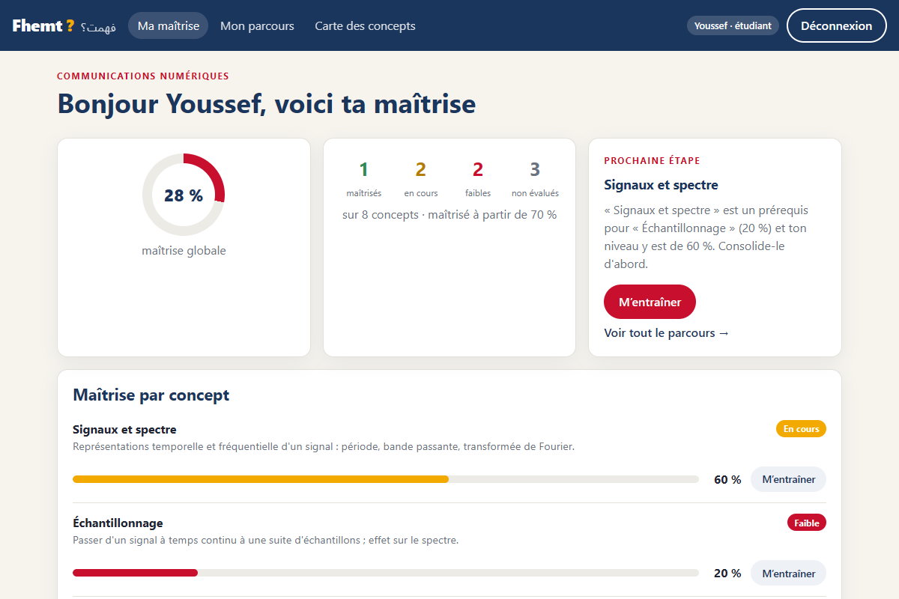
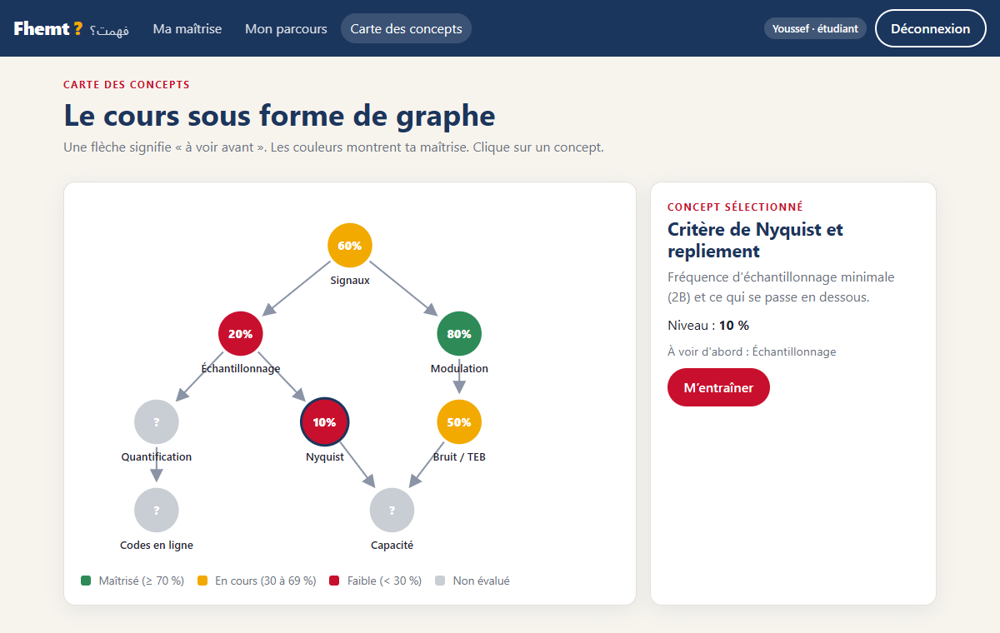
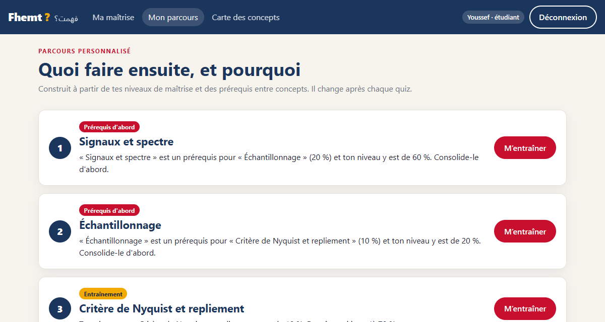
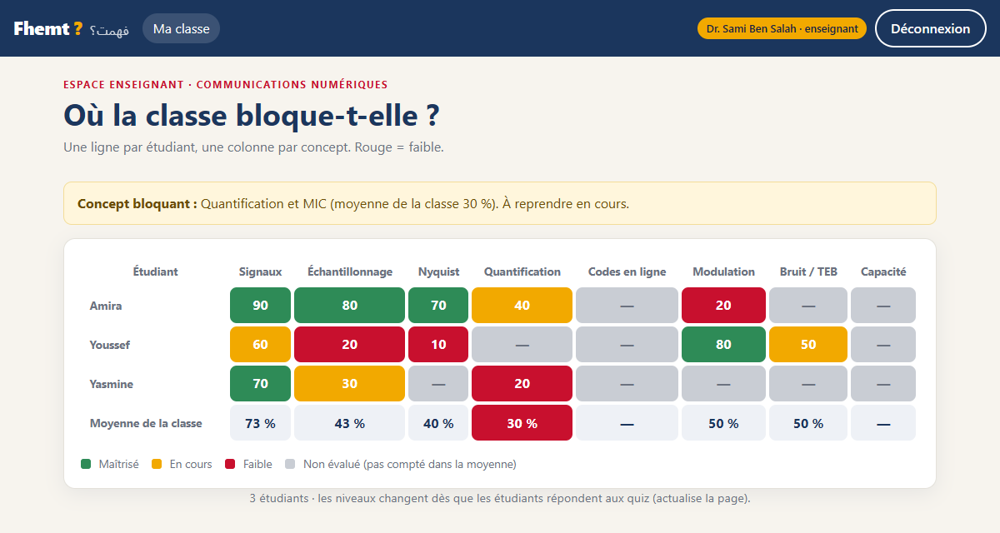

<div align="center">


[](https://fhemt.me)
[](https://github.com/RayenTouil/Fhemt-/actions/workflows/ci.yml)


**[▶ Essayer le site : fhemt.me](https://fhemt.me)**

</div>

---

## Pourquoi ce nom ?

**« Fhemt ? »** veut dire *« as-tu compris ? »* en arabe tunisien. Chaque étudiant se pose cette question la veille d'un examen, en général sans réponse claire. Fhemt ? y répond, **concept par concept**.

## Le problème

Les étudiants révisent ce qu'ils savent déjà et sautent le prérequis fragile. Les enseignants voient des notes, pas les concepts où la classe bloque.

Même note, lacunes opposées : la note cache ce que chaque étudiant doit réviser.

| Concept         | Amira · 12/20 | Youssef · 12/20 |
|-----------------|:-------------:|:---------------:|
| Échantillonnage | ✅ solide     | ⚠️ faible       |
| Nyquist         | ✅ solide     | ⚠️ faible       |
| Modulation      | ⚠️ faible     | ✅ solide       |

## Ce qu'est Fhemt ?

Une **application web éducative et interactive** : des quiz, un suivi de la progression, un parcours de révision personnalisé et, plus tard, un tuteur IA.
Première version : un seul cours, **Communications numériques** à Sup'Com.

**Proposition de valeur :** un parcours construit **pour chaque étudiant**, où chaque recommandation vient **avec sa raison**, et un tuteur IA qui répond **à partir du cours lui-même**.

## Public cible

| | Qui | Ce qu'ils attendent |
|---|---|---|
| 🎓 **Étudiants** (principal) | Étudiants d'écoles d'ingénieurs tunisiennes, 18–25 ans, qui étudient en français et en anglais | Savoir quoi réviser en premier, voir leur progression, avoir des réponses rapides. *« Plus que trois jours : par où je commence ? »* |
| 👩‍🏫 **Enseignants** (secondaire) | Responsables d'un cours et de ses exercices | Voir clairement où la classe bloque, de l'aide pour préparer les exercices. *« Quel prérequis dois-je reprendre en cours ? »* |

---

## Objectif 3 · Ce qui est construit (MVP)

Le périmètre du MVP vient de la priorisation des fonctionnalités de l'objectif 2 : d'abord la **boucle principale** (quiz → maîtrise → parcours → vue de la classe), les composants IA et l'infrastructure ensuite.

| Page | Route | Contenu dynamique | Pour qui |
|---|---|---|---|
| **Accueil** | `/` | Présentation, exemple, « comment ça marche » | tout le monde |
| **Connexion** | `/login` | Connexion par e-mail ; les nouveaux comptes sont étudiants, le rôle est stocké côté serveur | tout le monde |
| **Ma maîtrise** | `/dashboard` | Niveau global, compteurs, prochaine étape, une barre de progression par concept | étudiant |
| **Quiz** | `/quiz/:conceptId` | 3 questions par concept, correction immédiate et explication, maîtrise mise à jour après chaque réponse | étudiant |
| **Mon parcours** | `/path` | Les prochaines étapes avec leur raison (*« Échantillonnage » est un prérequis pour « Nyquist » (10 %) et ton niveau y est de 20 %*) | étudiant |
| **Carte des concepts** | `/concepts` | Graphe SVG des 8 concepts et de leurs prérequis, coloré selon la maîtrise, cliquable | étudiant |
| **Ma classe** | `/teacher` | Carte de chaleur étudiants × concepts, moyennes de la classe, concept bloquant | enseignant uniquement |

**Les règles du MVP (faciles à expliquer, faciles à changer) :**
- Maîtrise : bonne réponse **+20**, mauvaise réponse **−10**, niveau entre 0 et 100 ([`backend/src/services/mastery.js`](backend/src/services/mastery.js)).
- Un concept est **maîtrisé à partir de 70 %**, *en cours* à partir de 30 %, *faible* en dessous.
- Parcours : on suit l'ordre du cours ; un **prérequis faible passe toujours avant** le concept qui en dépend, et la raison le dit ([`backend/src/services/path.js`](backend/src/services/path.js)).
- Droits d'accès : le backend lit l'utilisateur dans l'en-tête `x-user-id` et vérifie le **rôle** (étudiant / enseignant / admin) sur les routes enseignant ; les guards Angular reproduisent ces vérifications pour la navigation.

**Contenu du cours :** 8 concepts de Communications numériques (signaux, échantillonnage, Nyquist, quantification, codes en ligne, modulation, bruit/TEB, capacité) avec leurs prérequis et 24 QCM expliqués, dans [`backend/data/seed/`](backend/data/seed/).

### Captures d'écran

| Tableau de maîtrise | Carte des concepts |
|---|---|
|  |  |

| Parcours personnalisé | Carte de chaleur enseignant |
|---|---|
|  |  |

## Le site en ligne : fhemt.me

**https://fhemt.me** est la version publique, en **mode démo**. GitHub Pages n'héberge que des fichiers statiques, donc il n'y a pas de serveur Express derrière : la même logique (mêmes données, mêmes règles) tourne dans le navigateur ([`frontend/src/app/core/demo-api.ts`](frontend/src/app/core/demo-api.ts)) et la progression de chaque visiteur reste sur son appareil. Un bandeau jaune le signale.

Comment c'est relié :

1. Le domaine **fhemt.me** est acheté chez **Namecheap** ; ses enregistrements DNS pointent vers les serveurs de GitHub Pages.
2. GitHub Pages sert le dépôt **[RayenTouil.github.io](https://github.com/RayenTouil/RayenTouil.github.io)**, qui contient uniquement le site compilé et le fichier `CNAME`.
3. `npm run deploy` (dans `frontend/`) compile le site et le publie dans ce dépôt ([`frontend/scripts/deploy.mjs`](frontend/scripts/deploy.mjs)). Le site est à jour en une minute environ.

Pour brancher fhemt.me sur la vraie API, il suffit d'héberger le backend (fichier [`render.yaml`](render.yaml) prêt pour Render, gratuit) et de mettre son adresse dans `frontend/src/environments/environment.prod.ts`.

## Lancer le projet en local (version complète avec l'API)

Prérequis : [Node.js](https://nodejs.org) 20 ou plus récent (testé avec Node 24). Rien d'autre à installer : pas de serveur de base de données, pas de Docker.

```bash
git clone https://github.com/RayenTouil/Fhemt-.git
cd Fhemt-

# Terminal 1 — l'API (http://localhost:3000)
cd backend
npm install
npm run dev          # crée data/db.json à partir des données seed au premier démarrage

# Terminal 2 — l'application Angular (http://localhost:4200)
cd frontend
npm install
npm start
```

Ouvre **http://localhost:4200** et connecte-toi avec un compte de démonstration :

| E-mail | Rôle | Ce que tu verras |
|---|---|---|
| `amira@fhemt.tn` | étudiante | à l'aise en échantillonnage, faible en modulation |
| `youssef@fhemt.tn` | étudiant | prérequis fragiles : le parcours le renvoie vers les signaux puis l'échantillonnage |
| `teacher@fhemt.tn` | enseignant | la carte de chaleur de la classe |

N'importe quel autre e-mail crée un nouveau compte étudiant. `npm run reset` dans `backend/` remet les données de démonstration.

**Routes de l'API :** `GET /api/health`, `GET /api/concepts`, `GET /api/mastery/me`, `GET /api/path/me`, `GET /api/quiz/:conceptId`, `POST /api/quiz/answer`, `GET /api/teacher/heatmap` (avec l'en-tête `x-user-id`). Détails dans [`backend/README.md`](backend/README.md).

## Tests et qualité

| Commande | Ce qu'elle vérifie |
|---|---|
| `npm test` dans `backend/` | les règles de maîtrise et de parcours (8 tests, testeur intégré à Node) |
| `npm test` dans `frontend/` | l'application Angular démarre (Vitest) |
| `npm run build` dans `frontend/` | la compilation de production |

À chaque push, GitHub Actions ([`.github/workflows/ci.yml`](.github/workflows/ci.yml)) compile le frontend, lance les tests et vérifie que l'API démarre et répond.

Le parcours complet (connexion, quiz, parcours, carte, vue enseignant, création de compte, rechargement) a été vérifié dans Chrome en mode API et en mode démo, sur ordinateur et à la largeur d'un téléphone.

## Structure du projet

```
Fhemt/
├── frontend/                  Angular 22 (composants standalone, signals, router)
│   ├── src/app/
│   │   ├── core/              api.ts (HttpClient + intercepteur), demo-api.ts (mode démo),
│   │   │                      auth.ts, guards.ts, models.ts, levels.ts
│   │   ├── shared/navbar/     barre de navigation selon le rôle
│   │   ├── pages/             home, login, dashboard, quiz, path, concept-map, teacher
│   │   ├── app.routes.ts      le plan du site
│   │   └── app.config.ts      router, HttpClient, choix API réelle / mode démo
│   ├── src/environments/      adresse de l'API (dev : localhost, prod : vide = mode démo)
│   ├── public/demo/           copie des données seed pour le mode démo
│   └── scripts/deploy.mjs     publication sur fhemt.me
├── backend/                   API REST Node.js + Express 5
│   ├── src/server.js          application, middlewares, routes
│   ├── src/routes/            auth, concepts, quiz, mastery, path, teacher
│   ├── src/services/          règles de maîtrise et de parcours (fonctions pures, testées)
│   ├── src/middleware/auth.js requireUser / requireRole (RBAC)
│   ├── src/store.js           stockage dans un fichier JSON (même forme que de futures requêtes MongoDB)
│   ├── data/seed/             concepts, questions, comptes et maîtrise de démonstration
│   └── test/                  tests des règles
├── .github/workflows/ci.yml   intégration continue
├── render.yaml                hébergement optionnel de l'API sur Render
└── assets/                    images du README
```

## Choix techniques

- **Angular** (le framework vu en cours) : composants standalone, **signals** pour l'état des pages, **router** pour les 7 pages avec des **guards**, `HttpClient` avec un **intercepteur** qui ajoute l'en-tête utilisateur, la nouvelle syntaxe `@if` / `@for`, et l'**injection de dépendances** pour basculer entre la vraie API et le mode démo sans toucher aux pages. Pas de bibliothèque d'interface : un petit design system écrit à la main ([`frontend/src/styles.css`](frontend/src/styles.css)) et une mise en page responsive (téléphone, tablette, ordinateur).
- **Express 5** pour un backend REST minimal : un fichier par fonctionnalité, des middlewares pour le contrôle d'accès, des fonctions pures pour les règles, donc testables sans HTTP.
- **Un fichier JSON comme base de données** pour le MVP : aucune installation pour le correcteur, et le module de stockage garde la forme des requêtes MongoDB, donc le passage à MongoDB ne touche qu'un fichier.
- **Connexion par e-mail** pour le MVP, avec le rôle décidé côté serveur. La connexion Google via Firebase remplacera la route de connexion sans toucher aux pages.

## Du MVP à l'architecture cible

L'architecture événementielle ci-dessous reste l'objectif. La priorisation de l'objectif 2 a décidé de ce dont le MVP a vraiment besoin.

| Composant | Dans le MVP (objectif 3) | Ensuite |
|---|---|---|
| Angular | ✅ 7 pages | page de discussion avec le tuteur IA |
| Node.js + Express | ✅ API REST, RBAC | vérification du jeton Firebase |
| Stockage JSON → **MongoDB** | ✅ fichier JSON | MongoDB Atlas (offre gratuite) |
| Connexion Google **Firebase** | ➖ connexion par e-mail | objectif suivant |
| **FastAPI + Qdrant + Groq** (tuteur, RAG) | ➖ | dernier objectif : le principal élément différenciant |
| **Cloudinary** (fichiers du cours) | ➖ | avec le tuteur |
| Cache **Redis** / événements **RabbitMQ** | ➖ | seulement si le tuteur ralentit les requêtes |
| E-mails **Mailjet** | ➖ exclus du MVP | optionnel |

## Architecture cible

Les actions rapides reçoivent une réponse tout de suite. Les tâches lentes (IA, e-mails, statistiques) passent par une **file de messages**, pour que l'étudiant n'attende jamais.

<p align="center">
  
</p>

**① Un étudiant répond à une question** — Node.js corrige la réponse (retour immédiat) et met à jour la maîtrise ; plus tard, le service IA affinera le parcours.
**② Un enseignant dépose un PDF de cours** — stocké sur Cloudinary, découpé et indexé dans Qdrant pour le tuteur.
**③ Un étudiant interroge le tuteur** — le tuteur retrouve les bons passages du cours (Qdrant), Groq rédige la réponse et cite la page.

## Droits d'accès (RBAC)

- **Trois rôles :** étudiant, enseignant, admin. Le rôle est stocké sur le serveur ; les nouveaux comptes sont étudiants.
- **Vérification 1, le rôle :** *« Un enseignant peut-il déposer un support de cours ? »*
- **Vérification 2, la propriété :** *« Est-ce **ton** cours ? »* Sinon, l'accès est refusé.

## Comment mesurer le succès

- Gain de maîtrise entre le premier quiz et la fin
- Un parcours adaptatif comparé à un parcours fixe sur un petit groupe d'étudiants
- Part des exercices terminés
- Étudiants actifs par semaine et questions posées au tuteur

## Avancement

- [x] **Objectif 1 :** définition du projet et périmètre fonctionnel
- [x] **Objectif 2 :** découverte produit assistée par l'IA (personas, matrice MVP, SWOT, concurrents)
- [x] **Objectif 3 :** MVP fonctionnel — 7 pages dynamiques, API Express, tests, site en ligne sur fhemt.me
- [ ] Ensuite : MongoDB Atlas, connexion Google Firebase, tuteur IA (RAG)

## Inspirations visuelles

[Khan Academy](https://www.khanacademy.org) · [Duolingo](https://www.duolingo.com) · [ALEKS](https://www.aleks.com) · [NotebookLM](https://notebooklm.google)

## Équipe

Projet web Sup'Com, réalisé par :

- **Rayen Touil**
- **Wajdi Zentani**

---

<div align="center">

**Fini de réviser à l'aveugle :** chaque étudiant sait ce qu'il maîtrise, ce qui lui manque et quoi faire ensuite, et chaque enseignant voit où la classe a besoin de lui.

</div>
